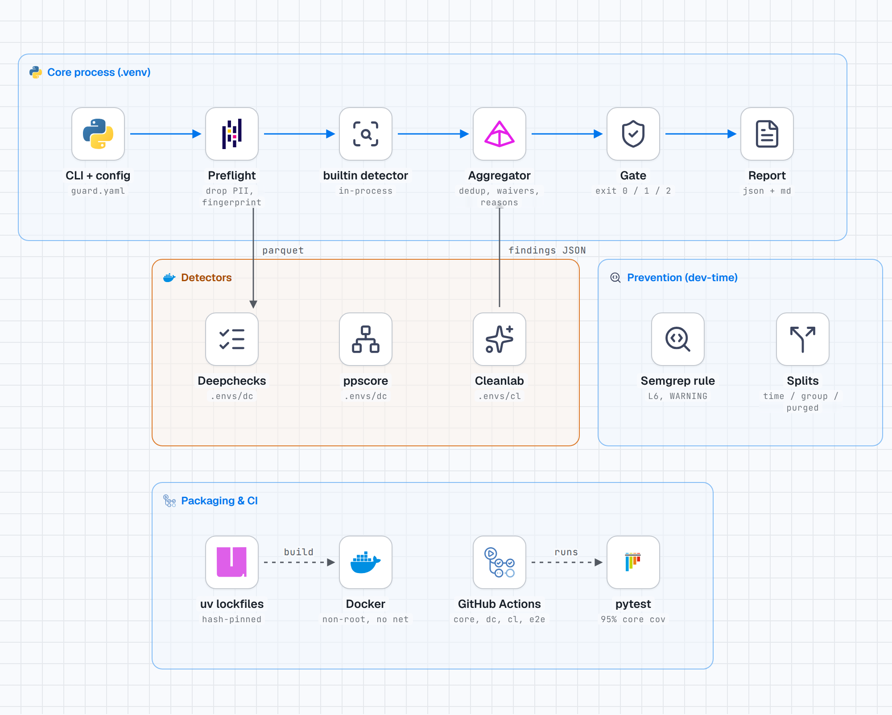

# Arsitektur (ringkas; rujukan: SPEC.md)

```
CLI (cli.py) -> run_guard (orchestrator.py)
  preflight  : validasi skema, drop PII, salinan kerja Parquet, fingerprint
  detectors  : builtin (in-process) | deepchecks, ppscore, cleanlab (subprocess per env)
  aggregator : dedup check_id+kolom, gabung sumber, waiver
  reasons    : template per check_id (katalog) -> alasan, confidence, basis ambang
  gate       : exit code dari temuan non-waived; GateHook opsional
  report     : report.json, report.md (+ lampiran HTML)
```

- **Core ringan**: hanya pandas, numpy, scikit-learn, pydantic, PyYAML. Pustaka berat hanya di environment detektor.
- **Kontrak detektor**: `Detector.run(DetectorContext) -> list[RawFinding]`; evidence hanya agregat (tanpa nilai baris). Runner (`runners/`) membaca spec JSON + Parquet, menulis JSON hasil atau `{"error": ...}`; crash/timeout/interpreter hilang -> exit 2 (atau WARNING `detector_unavailable` bila `allow_missing`).
- **Katalog** (`reasons/catalog.py`) satu-satunya sumber `check_id`: template, tipe leakage (L1-L8), basis ambang (default pustaka / desain / terkalibrasi). `validate_catalog()` memastikan placeholder terpenuhi evidence.
- **Pencegahan** (`prevention/`, `rules/semgrep/`) berdiri sendiri; tidak dijalankan oleh `run`.
- **Determinisme**: seed eksplisit (`runtime.seed`); dua run menghasilkan byte sama (AC-9).
- **Keamanan/privasi**: tanpa jaringan saat runtime, tanpa `shell=True`/`eval`, `yaml.safe_load`, tidak ada nilai data di log/laporan (AC-5).



Interactive version: `architecture-diagram.html` (self-contained). Dark: `architecture-diagram-dark.png`.
